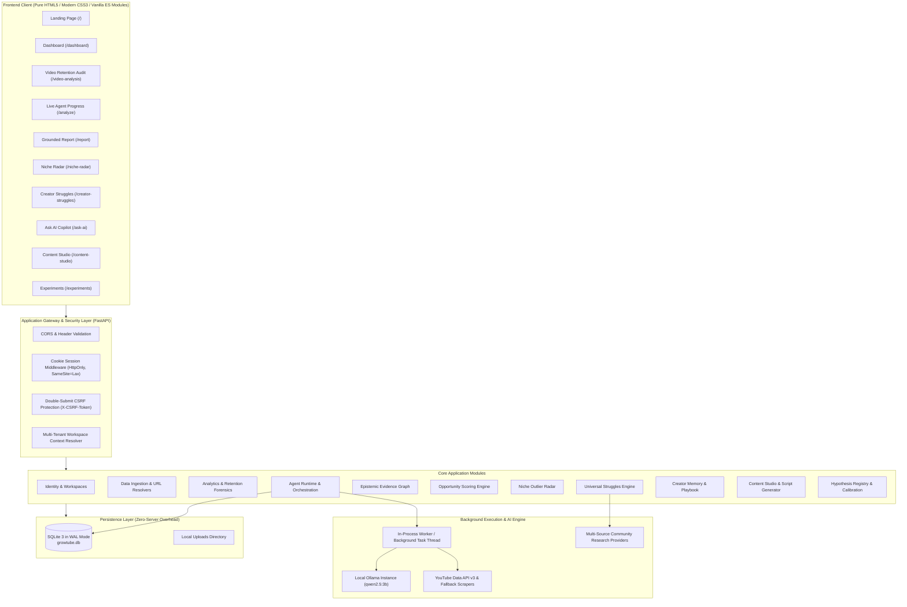
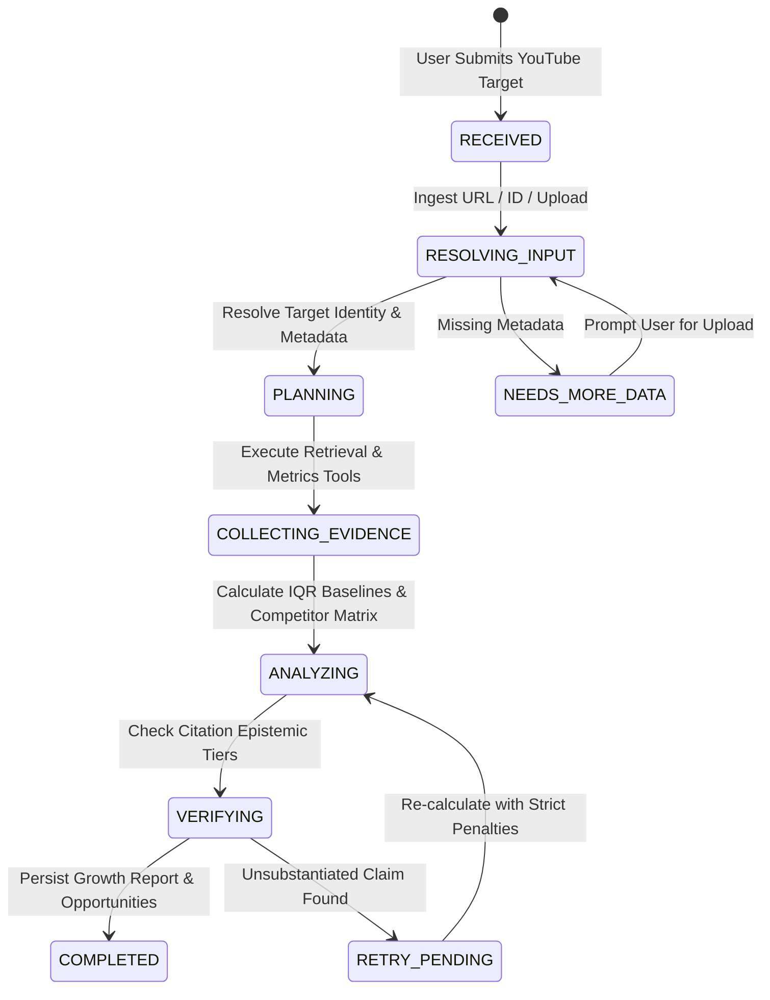

# GrowTube — YouTube Personal AI Growth Agent Platform

<div align="center">

<p align="center">
  
</p>

**An open-source, production-grade, multi-tenant agentic platform that analyzes YouTube channel and video performance, diagnoses retention and packaging friction using empirical evidence, and generates ranked opportunities and production-ready briefs.**

[](https://www.python.org/)
[](https://fastapi.tiangolo.com/)
[](https://www.sqlalchemy.org/)
[](https://www.sqlite.org/wal.html)
[](README.md)
[](LICENSE)

[Architecture](#1-system-architecture) • [Screens & UI](#2-editorial-frontend-screens) • [Agent Runtime](#3-bounded-agent-runtime--evidence-graph) • [Quickstart](#4-quickstart--local-setup) • [API Reference](#5-api-documentation) • [Configuration](#6-environment-configuration)

<br/>

<p align="center">
  
</p>

</div>

---

## 🌟 Key Capabilities at a Glance

| Pillar | Engineering Reality | Value Delivered |
| :--- | :--- | :--- |
| **📉 Retention Curve Forensics** | Second-by-second dropoff analysis, IQR outlier detection, hook friction scoring (0–30s) | Pinpoints the exact timestamp viewers abandon your video and diagnoses the cognitive cause. |
| **🤖 Bounded Agent Runtime** | 5-stage deterministic state machine with checkpoint recovery and durable background jobs | Autonomous analysis pipeline that executes safely without infinite loops or uncontrollable hallucination. |
| **🧠 Local LLM Reasoning** | Native Ollama integration running **Qwen 2.5 (3b)** with structured tool-calling capabilities | Zero external API fees, 100% data privacy, and full offline execution support. |
| **📊 Epistemic Evidence Graph** | 4-tier epistemic verification (Empirical, Derived, Benchmark, Heuristic) | Never gives generic advice — every finding cites concrete statistical proof. |
| **📡 Outlier Niche Radar** | Velocity-based 10x breakout detection across competitor channels and market niches | Uncovers high-performing, breakout video formats before topics become saturated. |
| **🔍 Universal Struggles Engine** | 4-source concurrent research across YouTube, Reddit, X (Twitter), and web articles | Solves creator blockers using real community discussions and battle-tested solutions. |
| **💬 Interactive Ask AI Copilot** | Context-aware streaming assistant with memory of channel playbook, history, and metrics | On-demand strategic partner for brainstorming, title audits, and retention troubleshooting. |
| **⚡ Zero Database Overhead** | Native SQLite with Write-Ahead Logging (WAL) and foreign keys enabled | Runs out of the box with zero external database servers (Postgres/Redis) required. |

---

## 1. System Architecture

GrowTube is engineered as a **modular monolith** with decoupled background task execution, strict tenant boundaries, and an editorial-intelligence frontend crafted in **semantic HTML5, modern CSS3, and vanilla ES modules**.



### Module Boundaries & Directory Layout

```
youtube-growth-agent/
├── frontend/                         # Pure HTML5, CSS3, Vanilla ES-Module Frontend
│   ├── index.html                    # Editorial Marketing Landing Page (Screen 1)
│   ├── pages/
│   │   ├── login.html                # Authentication & Workspace Switcher
│   │   ├── dashboard.html            # Channel Overview & 28-Day Performance (Screen 2)
│   │   ├── video-analysis.html       # Second-by-Second Retention & Hook Forensics
│   │   ├── analyze.html              # Input Submission & Live Agent Terminal (Screen 3)
│   │   ├── report.html               # Evidence-Based Growth Report (Screen 4)
│   │   ├── opportunities.html        # Ranked Content Opportunities (Screen 5)
│   │   ├── niche-radar.html          # Outlier Radar & 10x Breakout Signals
│   │   ├── creator-struggles.html    # 4-Source Universal Creator Struggles Engine
│   │   ├── ask-ai.html               # Contextual AI Growth Copilot & Chat
│   │   ├── content-studio.html       # Structured Script Generator & Audit (Screen 6)
│   │   └── experiments.html          # Hypothesis Registry & Memory Calibration
│   ├── css/                          # tokens.css, base.css, layout.css, components.css, pages.css
│   └── js/                           # config.js, api.js, auth.js, dashboard.js, analyze.js...
├── app/
│   ├── main.py                       # FastAPI Application Entrypoint & Static Server
│   ├── api/                          # HTTP Routers, Endpoints & Serialization
│   │   ├── deps.py                   # Tenant Context, Auth & DB Dependencies
│   │   └── v1/                       # Modular REST Routers (auth, videos, conversations...)
│   ├── agent/                        # Unified AI Agent Engine
│   │   ├── agent.py                  # Conversational Q&A & Strategy Agent
│   │   ├── orchestrator.py           # 5-Stage Bounded Workflow State Machine
│   │   ├── runtime.py                # Execution Manager (Runs, SSE Events)
│   │   ├── tools.py                  # Agent Tool Registry (24 bounded tools)
│   │   ├── memory.py                 # Creator Long-Term Memory & Playbook
│   │   ├── evidence.py               # 4-Tier Epistemic Evidence Graph
│   │   ├── state.py                  # State Machine & Typed Checkpoints
│   │   └── providers/                # LLM (Ollama/OpenRouter), YouTube, Tavily
│   ├── security/                     # Consolidated Security & Identity
│   │   ├── crypto.py                 # Password Hashing, JWT Tokens, CSRF, URL Safety
│   │   ├── service.py                # IdentityService, Sessions & Google OAuth
│   │   └── schemas.py                # User, Token, Workspace Schemas
│   ├── database/                     # Unified Persistence & SQLAlchemy Layer
│   │   ├── base.py                   # Declarative Base
│   │   ├── models.py                 # SQLAlchemy Declarative Models
│   │   ├── session.py                # Engine (WAL Mode) & SessionLocal Factory
│   │   └── init_db.py                # Table Creation, Compatibility & Seeding
│   ├── services/                     # Domain-Specific Business Logic
│   │   ├── video_analysis.py         # Retention Forensics & Drop-Off Diagnostics
│   │   ├── competitor_analyzer.py    # Channel Baseline & Competitor Matrix
│   │   ├── niche_radar.py            # Outlier Radar & Breakout Signals
│   │   ├── creator_struggles.py      # 4-Source Universal Community Research
│   │   ├── opportunity_engine.py     # Multi-Factor Opportunity Scoring
│   │   ├── content_studio.py         # Script Generation & 6-Point Checklist
│   │   ├── experiments.py            # Growth Hypothesis Tracking
│   │   ├── job_management.py         # Durable Background Job Tracking
│   │   └── data_ingestion.py         # Target Resolution & Ingestion
│   ├── core/                         # Shared Infrastructure (Config, Logging, Errors)
│   └── workers/                      # Durable Background Task Queue & Worker Thread
├── data/                             # SQLite Database Storage (growtube.db)
├── docs/                             # Platform Screenshots & Documentation
│   └── screenshots/                  # High-Resolution UI Walkthrough Screenshots
├── migrations/                       # Alembic Database Migrations (001 -> 006)
├── Dockerfile                        # Multi-Stage Container Spec
├── docker-compose.yml                # Compose Spec with Volume Persistence
├── requirements.txt                  # Pinned Python Dependencies
└── pyproject.toml                    # Project Configuration
```

---

## 2. Editorial Frontend Screens

The application features 11 dedicated, responsive screens styled with dark mode glassmorphism, tailored HSL color tokens, and micro-animations:

| Screen | Route | Key Capabilities |
| :--- | :--- | :--- |
| **Landing** | `/` | Editorial hero, value breakdown, interactive sample stats, feature highlights. |
| **Auth & Workspaces** | `/login` | Google Sign-In, local credentials, workspace switcher, and return-to URL routing. |
| **Channel Dashboard** | `/dashboard` | Real-time sparkline metrics (Views, CTR, Avg. Retention, Subscribers), 28-day performance chart with peak markers, and quick opportunity cards. |
| **Video Forensics** | `/video-analysis` | Second-by-second retention curve graph, 0–30s hook dropoff diagnosis, packaging audit (Title vs. Thumbnail match), and pacing lull identification. |
| **Agent Terminal** | `/analyze` | YouTube target input (URL, handle, or CSV/JSON/Transcript upload), 5-stage progress indicator (0% to 100%), and live event console. |
| **Growth Report** | `/report` | Evidence-backed Key Findings (e.g., 2.3x Tutorial multiplier), metric deficit diagnostics, and registered citations table. |
| **Opportunity Engine** | `/opportunities` | Multi-factor ranked topics filtered by category (Tutorials, High Potential, Tool Reviews), bookmarking, and search. |
| **Niche Outlier Radar** | `/niche-radar` | Real-time outlier video detection, view velocity calculations, and 10x breakout performance tracking across creators. |
| **Creator Struggles** | `/creator-struggles` | Universal research engine aggregating evidence from YouTube comments, Reddit communities, X discussions, and creator articles. |
| **Ask AI Copilot** | `/ask-ai` | Interactive conversational growth copilot with tool-execution visibility, video citations, and channel playbook awareness. |
| **Content Studio** | `/content-studio` | Hook/Intro/Chapter/CTA script generator with automated 6-point pre-publish checklist validation. |
| **Experiments** | `/experiments` | Hypothesis registry, pre-publish predictions vs. post-publish retention calibration to refine channel memory over time. |

### Visual Interface Walkthrough

#### 🚀 1. Editorial Marketing & Product Landing Page
> Editorial hero, value breakdown, live 5-stage agent pipeline indicator, and instant workspace launch.

<p align="center">
  
</p>

#### 📊 2. Channel Performance & Trajectory Dashboard
> Real-time public view counts, observed upload velocity (views/day), engagement ratios, peak upload velocity milestones, and multi-timeline trajectory curves.

<p align="center">
  
</p>

#### 📡 3. Niche Outlier Radar
> Live market discovery engine discovering high-velocity topic outliers, category rankings (Most Viewed, High Average Views, Gaining Momentum, Small-Channel Standouts), and emerging niche opportunities.

<p align="center">
  
</p>

#### 🔍 4. Universal Creator Struggles Engine
> 4-source grounded research engine querying YouTube tutorials, Reddit discussions, X posts, and creator guides to diagnose creator bottlenecks with verified evidence records.

<p align="center">
  
</p>

#### 💬 5. Ask GrowTube AI Copilot
> Grounded growth assistant equipped with persistent conversation history, one-click suggested inquiries (Underperformance Diagnostic, Competitor Comparison, Strategy), and tool execution visibility.

<p align="center">
  
</p>

#### 🎬 6. Video Intelligence & Retention Forensics
> Audit target submission input with quick-load examples, public baseline comparisons, pacing lulls, and drop-off diagnosis.

<p align="center">
  
</p>

#### 🔐 7. Frictionless Authentication & Google OAuth 2.0
> Single-click Google OAuth 2.0 sign-in, local credential authentication, and instant one-click Demo Creator access.

<p align="center">
  
</p>

---

## 3. Bounded Agent Runtime & Evidence Graph

GrowTube avoids uncontrolled LLM execution through a **deterministic 5-stage state machine**. The agent must traverse explicit validation checkpoints before generating recommendations.



### Deterministic Agent Tools

The agent orchestrator operates via 12+ bounded tool definitions:

1. `resolve_youtube_target`: Normalizes handles, custom URLs, video IDs, or local upload tokens.
2. `fetch_youtube_metadata`: Retrieves view counts, published dates, titles, tags, and channel baselines.
3. `search_competitors`: Queries high-performing benchmark videos across the creator's exact niche.
4. `retrieve_transcript`: Pulls and parses subtitle tracks or uploaded `.srt`/`.vtt`/`.txt` transcripts.
5. `calculate_video_metrics`: Computes daily velocity, IQR outlier thresholds, and baseline ratios.
6. `compare_videos_matrix`: Generates side-by-side packaging and performance comparison tables.
7. `extract_keywords_hashtags`: Isolates high-velocity semantic tags and topic clusters.
8. `identify_content_gaps`: Uncovers unmet audience search demand and under-served queries.
9. `generate_actionable_recommendations`: Constructs evidence-grounded tactical advice.
10. `verify_evidence_citations`: Enforces that every bullet point links to an immutable data point.
11. `persist_report_and_opportunities`: Writes verified artifacts to the SQLite database.
12. `consult_creator_memory` / `update_creator_memory`: Reads and writes creator voice, tone, and learned experiment outcomes.

### Epistemic Evidence Tiers

Recommendations are strictly classified by evidence strength:

- **Tier 1 (Empirical Primary)**: Direct YouTube Analytics or video retention timestamps (e.g., *72% viewer dropoff at 0:14*).
- **Tier 2 (Derived Statistical)**: Computed mathematically from verified data (e.g., *Tutorial CTR 1.8x above channel median*).
- **Tier 3 (External Benchmark)**: Comparative data drawn from top-performing competitor candidates in the same niche.
- **Tier 4 (Heuristic / Playbook)**: Creator memory rules or established video storytelling guidelines.

### Multi-Factor Opportunity Scoring Formula

The Opportunity Engine ranks topic ideas using a calibrated weighted formula:

$$\text{Opportunity Score} = w_{\text{demand}} \cdot S_{\text{demand}} + w_{\text{feasibility}} \cdot S_{\text{feasibility}} + w_{\text{impact}} \cdot S_{\text{impact}} - P_{\text{saturation}}$$

Where:
- $S_{\text{demand}}$: Search velocity, competitor view volume, and niche radar breakout signals.
- $S_{\text{feasibility}}$: Creator format alignment, production complexity, and channel memory match.
- $S_{\text{impact}}$: Projected subscriber conversion and watch-time multiplier.
- $P_{\text{saturation}}$: Penalty applied if the niche has been flooded with identical titles in the last 30 days.

---

## 4. Quickstart & Local Setup

### Prerequisites
- **Python 3.12+** installed on your system.
- **Zero external database setup** — runs directly on native SQLite with Write-Ahead Logging (WAL).
- *(Optional)* [Ollama](https://ollama.com/) installed for local AI agent reasoning.

---

### Installation (PowerShell / Windows)

```powershell
# 1. Clone repository and navigate to workspace
git clone https://github.com/Vinaykumar21798/Youtube-personal-Ai-agent.git
cd Youtube-personal-Ai-agent

# 2. Create and activate a virtual environment
python -m venv .venv
.\.venv\Scripts\Activate.ps1

# 3. Install pinned dependencies
python -m pip install -r requirements.txt

# 4. Copy environment configuration
Copy-Item .env.example .env

# 5. Apply database schema migrations
alembic upgrade head

# 6. Start the local server
python -m uvicorn app.main:app --reload --host 127.0.0.1 --port 8000
```

---

### Installation (Bash / Linux / macOS)

```bash
# 1. Clone repository and navigate to workspace
git clone https://github.com/Vinaykumar21798/Youtube-personal-Ai-agent.git
cd Youtube-personal-Ai-agent

# 2. Create and activate a virtual environment
python3 -m venv .venv
source .venv/bin/activate

# 3. Install pinned dependencies
pip install -r requirements.txt

# 4. Copy environment configuration
cp .env.example .env

# 5. Apply database schema migrations
alembic upgrade head

# 6. Start the local server
uvicorn app.main:app --reload --host 127.0.0.1 --port 8000
```

---

### Local AI Agent Setup (Ollama)

GrowTube uses a local **Qwen 2.5 (3b)** model by default to provide private, zero-cost intelligence:

```bash
# Install and run Ollama (if not already running)
ollama pull qwen2.5:3b
ollama serve
```

> [!NOTE]
> If Ollama is not running, GrowTube automatically falls back gracefully to deterministic rule-based analysis and heuristic algorithms so all features remain functional.

---

### Docker Deployment

To run GrowTube inside an isolated container:

```bash
# Build and run with Docker Compose
docker compose up --build -d

# View application logs
docker compose logs -f app
```

Access the application in your browser at `http://127.0.0.1:8000`.

---

## 5. API Documentation

Interactive OpenAPI documentation is generated automatically by FastAPI:
- **Swagger UI**: [http://127.0.0.1:8000/docs](http://127.0.0.1:8000/docs)
- **ReDoc**: [http://127.0.0.1:8000/redoc](http://127.0.0.1:8000/redoc)

### REST Endpoint Catalog

| Group | Method | Path | Description |
| :--- | :--- | :--- | :--- |
| **Authentication** | `POST` | `/api/v1/auth/login` | Local email/password authentication |
| | `POST` | `/api/v1/auth/logout` | Revoke session and clear HttpOnly cookie |
| | `GET` | `/api/v1/auth/me` | Current authenticated user, workspace, and role |
| | `GET` | `/api/v1/auth/google/login` | Initiate Google OAuth 2.0 flow |
| | `GET` | `/api/v1/auth/google/callback` | OAuth 2.0 callback with CSRF validation |
| | `POST` | `/api/v1/auth/workspaces/switch` | Switch active workspace within session |
| **Channels** | `GET` | `/api/v1/channels/overview` | 28-day channel aggregate metrics and chart points |
| **Videos** | `POST` | `/api/v1/videos/analyze` | Run retention curve & packaging forensics on a video |
| | `GET` | `/api/v1/videos/analyze` | Deep-linkable video analysis query |
| **Jobs** | `POST` | `/api/v1/jobs` | Enqueue background agent analysis job |
| | `POST` | `/api/v1/jobs/upload` | Upload CSV, JSON analytics, or subtitle files |
| | `GET` | `/api/v1/jobs/{job_id}` | Poll job progress and execution events |
| **Reports** | `GET` | `/api/v1/reports/latest` | Retrieve latest evidence-verified growth report |
| | `GET` | `/api/v1/reports/{id}` | Retrieve specific historical growth report |
| **Opportunities** | `GET` | `/api/v1/opportunities` | List ranked content opportunities with category filters |
| **Niche Radar** | `GET` | `/api/v1/niche-radar/suggest` | Get trending niche suggestions for active channel |
| | `GET` | `/api/v1/niche-radar/search` | Retrieve real-time outlier videos and breakout metrics |
| **Creator Struggles** | `GET` | `/api/v1/creator-struggles/suggestions` | Curated prompts for common creator bottlenecks |
| | `GET` | `/api/v1/creator-struggles/investigate` | Multi-source investigation across YouTube, Reddit, X |
| **Ask AI Copilot** | `POST` | `/api/v1/conversations` | Create a new discussion thread |
| | `POST` | `/api/v1/conversations/{id}/messages` | Send prompt and receive grounded AI answer with tool logs |
| **Content Studio** | `POST` | `/api/v1/studio/scripts/generate` | Generate structured script and pre-publish checklist |
| **Experiments** | `GET` | `/api/v1/experiments` | List hypothesis registry and post-publish outcomes |
| **Memories** | `GET` | `/api/v1/memories` | Retrieve active channel playbook and tone rules |

---

## 6. Environment Configuration

All settings are configured via `.env` and validated using Pydantic Settings:

| Variable | Default Value | Description |
| :--- | :--- | :--- |
| `APP_ENV` | `development` | Runtime environment (`development`, `production`, `test`) |
| `APP_PORT` | `8000` | Port for the Uvicorn web server |
| `DATABASE_URL` | `sqlite:///./data/growtube.db` | SQLite database URI (automatically resolved to absolute path) |
| `SECRET_KEY` | *(secure random string)* | Used for cryptographic session signing and tokens |
| `CSRF_SECRET` | *(secure random string)* | Secret for double-submit CSRF cookie validation |
| `SESSION_COOKIE_NAME` | `growtube_session` | Name of the authenticated session cookie |
| `SESSION_COOKIE_SECURE` | `false` | Set to `true` in production when serving over HTTPS |
| `LLM_PROVIDER` | `ollama` | AI reasoning provider (`ollama`) |
| `OLLAMA_BASE_URL` | `http://localhost:11434` | Endpoint for the local Ollama daemon |
| `OLLAMA_MODEL` | `qwen2.5:3b` | Target local model for agent reasoning and copilot |
| `YOUTUBE_API_KEY` | *(optional)* | Optional Google Data API v3 key for real-time live channel queries |
| `TAVILY_API_KEY` | *(optional)* | Optional search key for extended creator struggles community lookups |
| `GOOGLE_CLIENT_ID` | *(optional)* | Google OAuth 2.0 Client ID for Google Sign-In |
| `GOOGLE_CLIENT_SECRET` | *(optional)* | Google OAuth 2.0 Client Secret |

---

## 7. Testing & Quality Assurance

GrowTube includes an automated test suite covering deterministic formulas, API contracts, security tenant boundaries, and evidence grounding:

```powershell
# Run the entire test suite via the virtual environment
.\.venv\Scripts\python.exe -m pytest tests/ -v
```

### Test Suite Structure

```
tests/
├── unit/
│   ├── test_analytics.py           # IQR outlier logic, daily velocity, baseline calculations
│   └── test_schemas.py             # Pydantic v2 input/output payload validation
├── integration/
│   └── test_workflow.py            # End-to-end user auth, job submission, and report generation
├── security/
│   └── test_tenant_security.py     # Cross-tenant data isolation & RBAC enforcement
├── evaluations/
│   └── test_eval_evidence.py       # Verification that reports cite genuine empirical data
└── test_main.py                    # Health check, static file mounting, and SPA routes
```

---

## 8. Security & Multi-Tenant Design

1. **YouTube API Scope Isolation**: Google Sign-In strictly requests only identity scopes (`email`, `profile`, `openid`). It never requests YouTube write permissions or channel management access.
2. **Server-Side Session Store**: Authenticated users receive an opaque, cryptographically random session token stored in SQLite (`user_sessions` table) transmitted via an `HttpOnly`, `SameSite=Lax` cookie.
3. **Double-Submit CSRF**: All state-modifying requests (`POST`, `PUT`, `DELETE`, `PATCH`) validate both the `growtube_csrf` cookie and the `X-CSRF-Token` header.
4. **Tenant Boundary Enforcement**: Every database query is scoped to the authenticated `workspace_id`. Cross-tenant queries are blocked at the repository dependency level.
5. **SQLite WAL Concurrency**: SQLite is automatically initialized with `PRAGMA journal_mode=WAL`, `PRAGMA foreign_keys=ON`, and a 10-second busy timeout to ensure zero lock contention between background workers and web requests.

---

## 9. License

This project is licensed under the **MIT License**. You are free to modify, distribute, and build upon GrowTube for both personal and commercial use.
